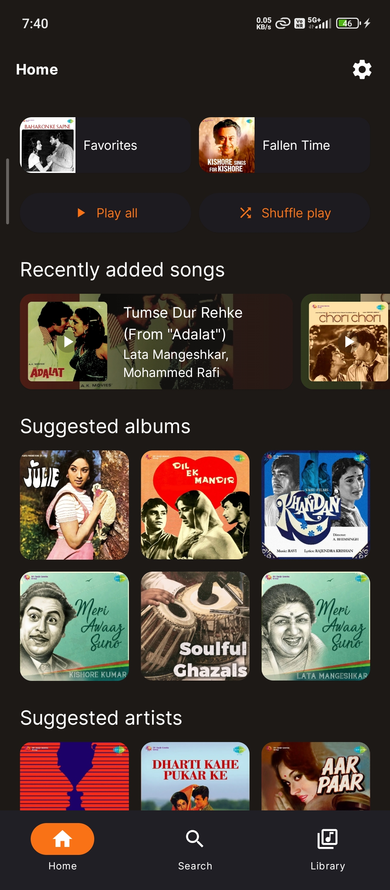
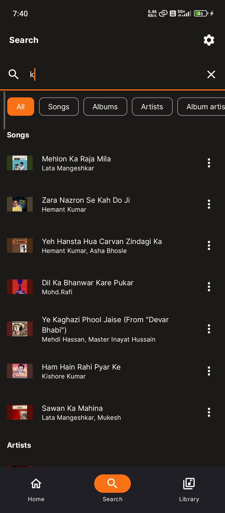
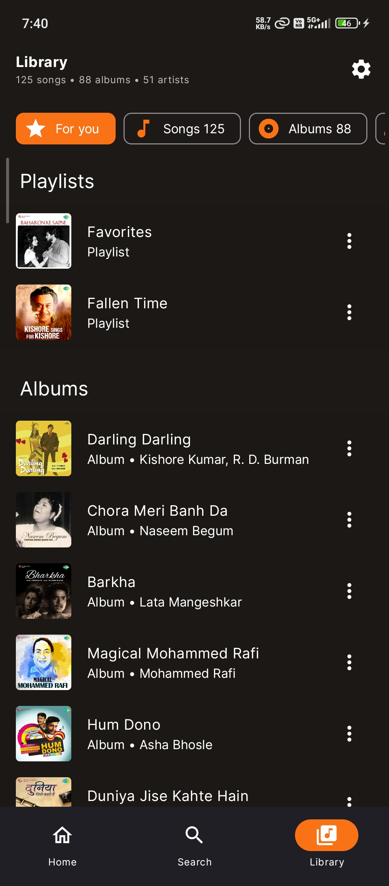
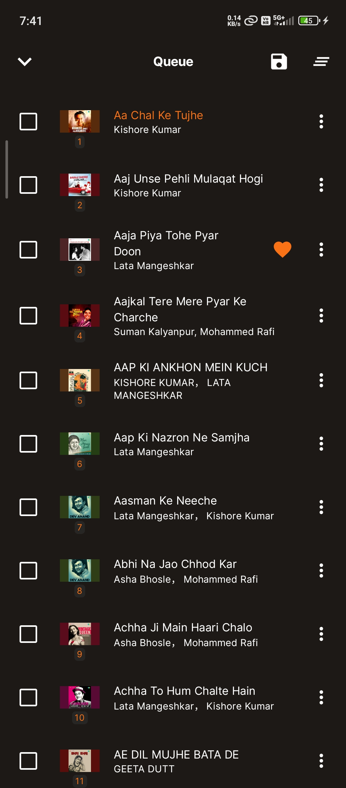

<h1 align="center">
  <br>
  Harmoniq
</h1>

## 📖 What is Harmoniq?

Harmoniq is a custom fork and major evolution of the original [Symphony](https://github.com/zyrouge/symphony) architecture. It has been extensively refactored to provide a premium, dynamic, and intuitive user experience that rivals popular streaming apps, while remaining fully offline-first. Designed with modern Android development paradigms, Harmoniq focuses heavily on a robust UI, performance, and seamless media playback synchronization.


<p align="center">
  A modernized, elegant, offline-first music player for Android, inspired by premium streaming experiences.
</p>

<p align="center">
  
  
  <a href="./LICENSE"></a>
</p>

<br>

<p align="center">
  
  
  
</p>

<p align="center">
  
  
  
</p>

## ✨ Key Features

- **Modern 3-Tab Architecture**: Quick, streamlined bottom navigation splitting the app into **Home**, **Search**, and **Library** tabs.
- **Premium Library UI**: Horizontal/vertical dynamic browsing for Playlists, Albums, Artists, and Genres using an intuitive swipeable pager interface.
- **Synchronized Lyrics**: Built-in LRC parsing for real-time scrolling, perfectly synchronized lyrics during playback (`Lyrics.kt`).
- **Dynamic Theming & Aesthetics**: Uses Compose and active Palette extraction to match UI colors to the currently playing album artwork seamlessly.
- **Advanced Media Managing**: Built-in playlist creation, track reordering, and fuzzy-search queries for navigating large local media libraries.
- **Performance Optimized**: English-only app with removed heavy legacy translations, leading to an incredibly lightweight, fast experience.
- **Custom Playback Engine**: Custom `Radio` subsystem managing continuous background playback state via native Android foreground services (`RadioNotificationService`).

## 🛠 Tech Stack

- **Language**: 100% Kotlin
- **UI Toolkit**: Jetpack Compose (`androidx.compose`)
- **Architecture**: MVVM / Clean Architecture principles using Compose state management
- **Local Database**: Room Database (`androidx.room`) for offline metadata caching and playlists
- **Image Loading**: Coil (`io.coil-kt`) optimized for Compose
- **Media Playback**: Custom Radio Session implementation natively integrated with Android Media components
- **Navigation**: Jetpack Compose Navigation (`androidx.navigation:navigation-compose`)
- **Concurrency**: Kotlin Coroutines & Flow

## 🏗 Architecture Overview

Harmoniq delegates logic across cleanly separated layers. The UI state is entirely driven by Compose flows reacting to the backend Custom playback service (`RadioSession`). 
- **UI Layer**: Comprised of full-screen routing components (`MainShell`), dedicated Tab contents, and granular rendering blocks (`view`/`components`).
- **Service Layer**: An isolated `services/radio` setup handles Android's Foreground Services, Notifications, Audio Focus, and continuous state streaming independently from UI fragments.
- **Data Layer**: Backed by `CacheDatabase` and `PersistentDatabase` managed via Room, handling queries asynchronously and feeding offline song data into the UI.

## 📂 Project Structure

```text
Harmoniq/
├── app/src/main/java/dev/anujyadav/harmoniq/
│   ├── services/       # Radio playback manager, Room databases, and core background handlers
│   ├── ui/             # Jetpack Compose UI trees, split by `view`, `components`, and `theme`
│   └── utils/          # Formatting, Fuzzy search algorithms, custom filesystem managers
├── metaphony/          # Submodule dedicated to media metadata handling/extraction
└── build.gradle.kts    # Project-level configurations and Kotlin build scripts
```

## 🚀 Build Instructions

### Prerequisites
- Android Studio (latest stable release)
- JDK 17
- Android SDK (Compile API 35)

### Building from Source

1. Clone the repository:
   ```bash
   git clone https://github.com/AnujYadav-Dev/Harmoniq.git
   cd Harmoniq
   ```
2. Build the debug APK via Gradle Wrapper:
   ```bash
   ./gradlew :app:assembleDebug
   ```
3. To install directly to an attached device:
   ```bash
   ./gradlew :app:installDebug
   ```

## 📦 Installation Instructions (APK)

If you don't wish to compile the project yourself, simply:
1. Go to the [Releases](https://github.com/AnujYadav-Dev/Harmoniq/releases) page of this repository.
2. Download the latest `Harmoniq-vX.X.X.apk`.
3. Transfer it to your Android device.
4. Open the APK file and select "Install" (ensure "Install from Unknown Sources" is enabled in your device settings).

## 🤝 Contributing

We welcome pull requests! For major changes, please open an issue first to discuss what you would like to change. Ensure to update any relevant Compose preview functions, test cases, and adhere to the existing Kotlin style formatting throughout the `app` module.

## 🙏 Acknowledgements

Harmoniq was originally born as a heavily customized fork of **Symphony** by [zyrouge](https://github.com/zyrouge). Massive thanks to the original author for creating the structural bedrock of this offline music player experience. 

## 📄 License

This project is licensed under the terms of the [AGPL-3.0 License](./LICENSE).
